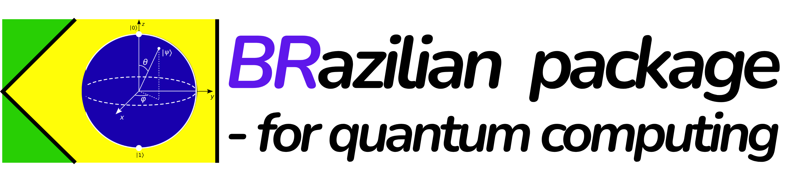

<p align="center">
  
</p>

<p align="center">
  <a href="https://github.com/GubioGL/Q-BASIC/actions/workflows/testes.yml"></a>
  <a href="https://github.com/GubioGL/Q-BASIC/actions/workflows/docs.yml"></a>
  <a href="https://pypi.org/project/Q-BASIC/"></a>
  <a href="https://www.python.org/"></a>
  <a href="https://github.com/GubioGL/Q-BASIC/blob/main/LICENSE"></a>
  
</p>

---

## 🚀 Sobre o Projeto

### Q-BASIC: Simulador Quântico Brasileiro 🇧🇷⚛️
(Quantum Brazilian Algorithms, SImulations, and Computational tools) é um simulador quântico open-source, feito no Brasil, para ensino, pesquisa e desenvolvimento de algoritmos quânticos. Foco em acessibilidade, didática e flexibilidade para simular sistemas quânticos, computação quântica e redes neurais quânticas. Uma versão customizada do QuTiP desenvolvida com **NumPy** e **PyTorch**, contendo métodos adicionais criados pelo nosso grupo de pesquisa na UFSCar.


---
## ✨ Principais Recursos

- Simulação de sistemas quânticos (computação e óptica)
- Algoritmos quânticos básicos e avançados
- Backend customizável: NumPy, PyTorch, CuPy, Numba (em desenvolvimento)
- Suporte a matrizes densas e esparsas
- Ferramentas didáticas para ensino
- Código 100% Python, fácil de modificar

---

## 🖥️ Demonstração Rápida

```python
import qbasic as qb

psi = qb.ket("0")  # estado |0>
X = qb.pauliX()  # porta NOT quântica
psi_final = X * psi  # "*" é o produto matricial: X|0> = |1>
print(psi_final)

bell = (qb.ket("00") + qb.ket("11")) / 2**0.5  # estado de Bell (2 qubits)
print(qb.valor_esperado(bell, qb.tensor(qb.pauliZ(), qb.pauliZ())))  # correlação <ZZ> = 1
```

Dinâmica (oscilação de Rabi de um qubit, com `H = (Ω/2) σx`):

```python
import numpy as np
import qbasic as qb

tempos = np.linspace(0, 10, 101)
H = 0.5 * qb.pauliX()  # Ω = 1
resultado = qb.resolver_schrodinger(H, qb.ket("0"), tempos, observaveis=[qb.pauliZ()])
print(resultado.valores_esperados[0][:3])  # <σz>(t) = cos(Ω t)
```

Convenções: `A * B` é o produto matricial, `A @ B` (ou `qb.tensor(A, B)`) é o produto
tensorial e `sparsa=True` cria os objetos em formato esparso.

---

## 📂 Estrutura do Projeto

```text
Q-BASIC/
├── src/qbasic/                  # O pacote (núcleo do simulador)
│   ├── objeto.py                # Classe base ObjQuantico (densa ou esparsa)
│   ├── estados.py               # bases, ket, bra, fock, coerente, matriz_densidade
│   ├── operadores.py            # identidade, criação/destruição, x, p, Pauli, tensor
│   ├── portas.py                # portas quânticas (H, S, T, rotações, CNOT, ...)
│   ├── medidas.py               # valores esperados, traço parcial, entropia, fidelidade
│   ├── dinamica.py              # equações de Schrödinger e de Lindblad
│   └── visualizacao.py          # LaTeX, Wigner, esfera de Bloch e gráficos
├── tests/                       # Testes unitários (pytest)
├── exemplos/                    # Scripts prontos (ex.: Jaynes-Cummings)
├── benchmarks/                  # Medições de desempenho
├── tutoriais/                   # Notebooks: simulador (aulas 0–12) e computação quântica
├── docs/                        # Documentação (site HTML com Sphinx)
├── tutorial_latex/              # Modelo do livro dos tutoriais (LaTeX/PDF)
├── paper/                       # Artigo sobre a biblioteca para o JOSS (inglês)
├── .github/workflows/           # CI: testes em todo commit e publicação no PyPI
├── pyproject.toml               # Configuração do pacote
├── CHANGELOG.md                 # Novidades de cada versão e guia de migração
└── PLANO_DE_TRABALHO.md         # Roteiro da reestruturação
```
---

## 📦 Instalação

Pelo PyPI:

```bash
pip install Q-BASIC
```

Extras opcionais: `Q-BASIC[plot]` (gráficos com matplotlib), `Q-BASIC[tutorial]`
(Jupyter e QuTiP para os notebooks) e `Q-BASIC[gpu]` (PyTorch).

Para desenvolver (recomenda-se um ambiente virtual):

```bash
git clone https://github.com/GubioGL/Q-BASIC.git
cd Q-BASIC
pip install -e ".[dev]"
pre-commit install
```

---

## 🧑‍💻 Como Usar

📖 **Documentação completa:** <https://gubiogl.github.io/Q-BASIC/> (guia rápido, guia do
usuário, tutoriais e referência da API).

- Siga os [tutoriais](https://github.com/GubioGL/Q-BASIC/blob/main/tutoriais) (notebooks): da construção do simulador à computação quântica.
- Leia os tutoriais como livro: `make livro` gera o PDF (ou baixe-o nos arquivos de cada
  release).
- Rode os scripts de [`exemplos/`](https://github.com/GubioGL/Q-BASIC/blob/main/exemplos).
- Importe os módulos do pacote `qbasic` para criar seus próprios experimentos.

> **Vindo da versão 0.0.x?** Os nomes com acento ou maiúsculas (`destruiçao`, `criaçao`,
> `Identidade`, `Fock`, `edo.solve`, `Valor_esperado`...) continuam funcionando, mas
> mostram um aviso com o nome novo. Veja a tabela completa no
> [CHANGELOG](https://github.com/GubioGL/Q-BASIC/blob/main/CHANGELOG.md).

---

## 🧪 Testes

Os testes unitários rodam automaticamente no GitHub Actions a cada commit e pull request
(Python 3.10 a 3.14; Linux, Windows e macOS). Para rodar localmente:

```bash
pytest                                  # todos os testes
pytest --cov=qbasic                     # com cobertura
make lint                               # estilo e erros comuns (ruff)
```

Veja [`tests/README.md`](https://github.com/GubioGL/Q-BASIC/blob/main/tests/README.md) para o que cada arquivo de teste cobre.

---

## 🛣️ Roadmap

- [x] Simulação básica de qubits
- [x] Matrizes esparsas (corrigido)
- [ ] Backend PyTorch
- [ ] Backend CuPy (GPU)
- [ ] Backend Numba (otimização)
- [ ] Solve para matrizes esparsas
- [ ] Mais exemplos e notebooks
- [ ] **BRa |ψ⟩** — pacote dedicado ao ensino de algoritmos de computação quântica
  (nome inspirado no Brasil e na notação "bra" da mecânica quântica)

---

## 🤝 Contribua!

Contribuições são super bem-vindas! Se você curte computação quântica, educação ou Python, junte-se a nós:

- Faça um fork do projeto
- Crie uma branch com sua feature
- Instale o ambiente de desenvolvimento (`pip install -e ".[dev]"` e `pre-commit install`)
- Garanta que `pytest` e `make lint` passam
- Envie um Pull Request

Para lançar uma nova versão no PyPI, veja o [guia de publicação](https://github.com/GubioGL/Q-BASIC/blob/main/docs/source/desenvolvimento/publicacao.md).

---

## 👨‍🔬 Créditos & Contato

Desenvolvido por Gubio e membros do grupo de pesquisa da UFSCar.

- Email: gubiofisikal@gmail.com

---

<p align="center">
  <b>Democratizando a computação quântica no Brasil!</b>
</p>
